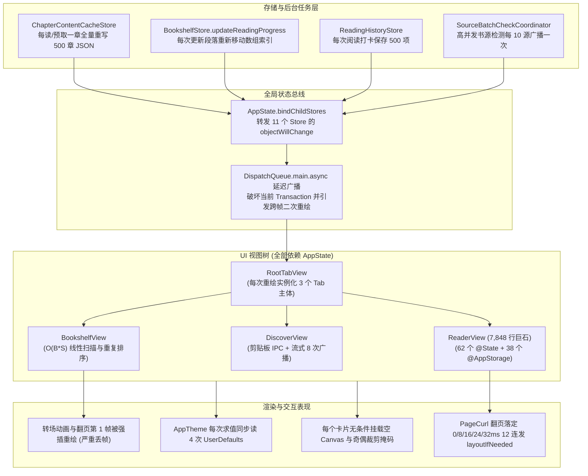

# SourceReadSwift2 架构与性能深度审计技术报告 (全量归档版)

> **项目目标**：全面挖掘 `SourceReadSwift2` 的架构缺陷、代码异味、掉帧卡顿源头与并发隐患，覆盖全局状态、设计系统、四大阅读排版引擎、书架/书案 3D 动效、底层存储与规则执行引擎。  
> **核心结论**：所有性能瓶颈均源于“冗余全树重绘、热路径同步 I/O 与查表、无用离屏渲染图层、转场关键帧主线程自爆与伪优化空壳”，**完全无需削减任何毛玻璃、3D 书封、视差动效或业务功能**即可实现极致流畅（120Hz）。

---

## 目录
1. [系统级掉帧与性能衰退核心模型](#一-系统级掉帧与性能衰退核心模型)
2. [全局层与设计系统 (App / Theme / DesignSystem / Performance)](#二-全局层与设计系统)
3. [阅读器子系统 (Reader View & 四大排版翻页引擎)](#三-阅读器子系统)
4. [书架、悬浮书案与交互转场 (Bookshelf & Transitions)](#四-书架悬浮书案与交互转场)
5. [发现页、书源管理与设置统计 (Discover / SourceManager / Settings)](#五-发现页书源管理与设置统计)
6. [核心引擎、JSCore 与存储并发 (Engine / Rules / JSCore / Storage)](#六-核心引擎-jscore-与存储并发)
7. [零视觉/功能妥协的无损优化路线图](#七-零视觉功能妥协的无损优化路线图)

---

## 一、 系统级掉帧与性能衰退核心模型



---

## 二、 全局层与设计系统

### 2.1 `AppState.swift`：全局 `objectWillChange` 广播雪崩与时序破坏
- **文件路径**：`SourceReadSwift/App/AppState.swift`
- **问题代码**：
  - 行 119–129 (`scheduleStoreNotification()`)
  - 行 192–263 (`bindChildStores()`)
- **深层机理剖析**：
  1. **11 个 Store 聚合引发的全树重绘**：`bindChildStores()` 将 11 个子 Store（`sourceStore`、`bookshelfStore`、`purifyRuleStore`、`chapterContentCacheStore`、`chapterDownloadStore`、`rssArticleStateStore`、`rssFeedCacheStore`、`rssArticleContentCacheStore`、`sourceHealthStore`、`sourceDiagnosticHistoryStore`、`readingHistoryStore`）的变更全部汇流至 `AppState.objectWillChange`。任何后台缓存预读、阅读历史打卡、下载进度更新，均会导致观察了 `appState` 的所有已挂载视图全部重新评估 `body`。
  2. **违反 SwiftUI 变更契约的延迟派发**：`scheduleStoreNotification()` 使用 `DispatchQueue.main.async { self.objectWillChange.send() }`。SwiftUI 依赖“变更发生前同步发出 `objectWillChange`”以合并渲染事务。延迟到下一 RunLoop 触发会导致正在进行的动画被撕裂，并在每轮状态更新中形成**先局部刷、后全局再刷一遍的双重渲染跳跃**。

### 2.2 `AppTheme.swift` & `AppVisualTheme.swift`：热路径无缓存 `UserDefaults` 查询与闭包堆分配
- **文件路径**：
  - `SourceReadSwift/Shared/DesignSystem/AppTheme.swift` (行 4–39)
  - `SourceReadSwift/Shared/DesignSystem/AppVisualTheme.swift` (行 23–28, 95–119)
- **深层机理剖析**：
  1. `AppVisualTheme.current`、`AppTheme.background`、`AppTheme.card`、`AppTheme.accent` 等全部为无缓存计算属性。
  2. 仅单次访问 `AppTheme.accent`，就会同步调用 `UserDefaults.standard.string(forKey:)` **4 次**、执行 3 次十六进制字符解析 `UInt32(raw, radix: 16)`，并分配一个新的 `UIColor { traits in ... }` 动态闭包对象。
  3. 列表中滚动时，屏幕内所有组件（文本、徽章、边框、卡片）在单帧内可访问该系列属性达数千次，在主线程产生大量同步字典查询与瞬时垃圾对象。

### 2.3 `AppThemeSurface.swift`：通用卡片修饰器强制多重离屏渲染与过度绘制
- **文件路径**：
  - `SourceReadSwift/Shared/DesignSystem/AppThemeSurface.swift` (行 65–80)
  - `SourceReadSwift/Shared/DesignSystem/AppThemeOrnament.swift` (行 4–49)
- **深层机理剖析**：
  1. **无条件挂载空 Canvas**：行 71 `.overlay { AppThemeOrnament(theme: theme, isCard: true) }` 为每一个 `.glassPanel()` / `.podcastCard()` 挂载一个基于 Metal/CGContext 的 `Canvas`。但对于 `.classic`、`.forest`、`.editorial` 等绝大多数主题，该 Canvas 内部完全为空操作（直接退出），却白白为每个卡片增加了视图层级与合成开销。
  2. **奇偶裁剪掩码 (eoFill) 阻断硬件直通**：行 78 `.clipShape(AppThemeCardShape(theme: theme, radius: radius), style: FillStyle(eoFill: true))` 结合无 `shadowPath` 的模糊阴影（行 79），强制 RenderServer 为每一个卡片创建离屏缓冲区（Offscreen Buffer）进行动态 Alpha 遮罩生成与模糊卷积。

### 2.4 `FrameRateCoordinator.swift`：高刷协调器全量失效与虚假度量
- **文件路径**：
  - `SourceReadSwift/Shared/Performance/FrameRateCoordinator.swift` (行 14–88)
  - `SourceReadSwift/Shared/Performance/AppFrameProfiler.swift` (行 8–39, 67–118)
  - `SourceReadSwift/App/SourceReadSwiftApp.swift` (行 19–34)
- **深层机理剖析**：
  1. `SourceReadSwiftApp` 挂载了 `FrameRateSceneAnchor`、`UIScene.didActivateNotification` 与 `scenePhase` 触发器调用 `FrameRateCoordinator.apply()`，但 `FrameRateCoordinator.apply` **内部只有一行 `os_signpost` 打印，没有任何配置系统帧率的代码**。同文件声明的 `preferredRange` 从未被调用。
  2. `AppFrameProfiler` 用当前帧的 `link.targetTimestamp - link.timestamp` 去计算上一帧耗时 `seconds`，在 ProMotion 屏幕从 10Hz/24Hz 静态待机切到 120Hz 交互触摸时，数学上必然得出 `100ms / 8.33ms ≈ 12`，将正常的变频节能行为误判为连续严重掉帧。

### 2.5 `CachedRemoteImage.swift` & `RemoteImageLoader.swift`：缓存命中仍闪烁 1 帧与无界线程池竞争
- **文件路径**：
  - `SourceReadSwift/Shared/DesignSystem/CachedRemoteImage.swift` (行 43–77)
  - `SourceReadSwift/Shared/DesignSystem/RemoteImageLoader.swift` (行 225–369)
- **深层机理剖析**：
  1. **同步命中逻辑旁路**：`CachedRemoteImage.readyBitmap` 中设置了 `guard reuseCoverBytes, headers.isEmpty, let url else { return nil }`。而列表中绝大多数封面 `reuseCoverBytes` 为 `false`，导致即便图片已在内存 `NSCache` 中，首帧也必定走 `placeholder()`，等待下一 RunLoop `.task` 异步回填，滚动时每行卡片均出现一次可见闪烁与双重排版。
  2. **GCD 线程池爆炸**：`RemoteImageLoader` 在降采样时无节制向 `DispatchQueue.global(qos: .utility)` 派发闭包，大批量封面同时划入时，数十个 CGImage 解码任务瞬间占满多核，剥夺主线程计算资源。

---

## 三、 阅读器子系统

### 3.1 `ReaderView.swift`：7,848 行单文件巨石架构的计算风暴
- **文件路径**：`SourceReadSwift/Features/Reader/ReaderView.swift`
- **问题代码与度量**：
  - 拥有 62 个 `@State`、38 个 `@AppStorage`、2 个 `@StateObject`，全文件达 7,848 行。
  - 行 3678–3698 (`readerResolvedSafeInsets`)：每次访问均遍历 `UIApplication.shared.connectedScenes` 与所有窗口；单次 `ReaderView.body` 求值被 `pagedPageGeometry`、`readerHeader`、`readerFooter` 等重复调用 15 次以上。
  - 行 748–861 (`readerPageCacheKey` 等缓存键)：在单次渲染中产生超 100 次 `String(format: "%.1f", ...)` 格式化与字符拼接。
  - 行 425–441 (`chapterPageTotal`)：每次页面渲染页脚均线性扫描 `pagedBlocks`，多页缓存下放大为 $O(5 \times N)$ 扫描；`declaredChapterNumber` 每次求值均重新编译正则匹配章节号。

### 3.2 仿真翻页 (`PageCurlReaderView.swift`)：主线程 12 连发排版轰炸与吞点击
- **文件路径**：`SourceReadSwift/Features/Reader/PageCurlReaderView.swift` (行 258–325, 517–553)
- **深层机理剖析**：
  1. **12 连发主线程排版**：每次翻页落定或 `sync()`，`Coordinator.prewarm(around:)` 按照 `[0, -1, 1, -2, 2, -3, 3, -4, 4, -5, 5, -6, 6]` 向主队列投递 12 个任务，延迟为 `0ms, 8ms, 16ms, 24ms, 32ms, 48ms, ...`。
  2. **强制同步 `layoutIfNeeded()`**：在预热闭包内直接创建 `PageHostingController` 并强制执行 `controller.view.layoutIfNeeded()`，触发布局与 TextKit `ensureLayout`。这使得翻页后 **144ms 内主线程持续被重型布局任务抢占**，用户下一次划动触摸直接被卡住。
  3. **280ms 强制吞点击**：`ReaderView.swift:5659` 设置了 `tapCooldownUntil = now.addingTimeInterval(0.28)`，且 `PageCurlReaderView.requestTurn` 遇到交互进行中直接丢弃，导致快速连点翻页严重失灵。

### 3.3 覆盖/平移翻页 (`CoverPageReaderView.swift`)：落定帧控制器挂载与多重监听
- **文件路径**：`SourceReadSwift/Features/Reader/CoverPageReaderView.swift` (行 211–252, 295–302, 364–377)
- **深层机理剖析**：
  1. 翻页动画结束瞬间，`install(_:)` 在主线程为新滑入窗口的页面同步创建 `UIHostingController`，挂载进视图树并调用 `layoutIfNeeded()`。
  2. `ReaderView.swift` 中同时存在 3 处针对 `pagedPageIndex` 的 `.onChange` 监听（行 1365、2839、2977），单次翻页造成同一组可见段落上报和预热逻辑重复跑 3 遍。
  3. `pageSurface` 为每一页独立挂载 `GeometryReader` + `TimelineView` + 全屏背景图层，缓存池维持多套完全重复的重型图层。

### 3.4 进场双重同步分页与排版滑块风暴
- **文件路径**：`SourceReadSwift/Features/Reader/ReaderView.swift` (行 645–662, 1267, 1474–1482, 4507–4522)
- **深层机理剖析**：
  1. **进场双重分页**：打开书籍时，`onAppear` 先用未初始化的预估视口尺寸在主线程同步排版整章；1 帧后子控制器汇报真实尺寸，`adoptPageContainerMetrics` 改变签名，导致刚排好的数据全部作废，在转场关键帧中立即执行第二次主线程同步排版。
  2. **排版滑块逐帧打爆缓存**：字号、行距、边距滑块直接绑定 `@AppStorage`。拖动滑块时，`.onChange(of: chapterTypographySignature)` 毫无防抖，每一帧（16ms/8ms）都在主线程清空 `chapterPageCache` 与 `ReaderPageTextCache`，并强行重建所有可见控制器的富文本与排版。

### 3.5 滚动模式 (Web & 原生) 掉帧根因
- **文件路径**：
  - `SourceReadSwift/Features/Reader/WebScrollReaderView.swift` (行 267–290, 375–390, 587–642)
  - `SourceReadSwift/Features/Reader/WebReaderDocument.swift` (行 1230–1263)
  - `SourceReadSwift/Features/Reader/NativeReaderTextView.swift` (行 101, 599–618, 1175–1220)
- **深层机理剖析**：
  1. **Web 模式 27 章全量重传**：滑动窗口保留前 20 章 + 后 7 章。每当追加 1 章，代码将全部 27 章完整打包（包含繁简转换与双层转义 JSON），通过 `evaluateJavaScript` 跨进程注入，WebKit 每次均通过 `querySelectorAll` 重新抓取上万个 DOM 节点。
  2. **滚动中 DOM 强制回流**：JS 侧在滚动过程中每 120ms 执行 `visibleTextOffset`，其二分查找循环内每一步都在创建 `TreeWalker` 与 `Range.getBoundingClientRect()`，造成 WebKit 主线程持续高频 Reflow。
  3. **原生滚动模式整章排版**：`NativeReaderTextView` 设置 `allowsNonContiguousLayout = false`，窗口拼接时在主线程对数千段落执行一次性连续排版，并在 `paragraphShift` 中进行 $O(N^2)$ 字符串切片比对。

---

## 四、 书架、悬浮书案与交互转场

### 1. 点击打开书籍转场：转场首帧的三重自爆
- **文件路径**：
  - `SourceReadSwift/Features/Bookshelf/BookshelfReaderGatewayView.swift` (行 46–58, 212–220)
  - `SourceReadSwift/Features/Bookshelf/ReaderBookPassageController.swift` (行 44–99)
- **深层机理剖析**：
  1. 用户在书架点击封面启动 iOS 18 Zoom 缩放动画的第 1 帧：
     - `onAppear` 触发 `acquireTabChromeHidden`，底栏 safeAreaInset 弹簧动画启动，强制整个外层 NavigationStack 在缩放过程中逐帧改变高度；
     - `.task` 立即调用 `markReaderOpened` 与 `markUpdatesSeen`，对书架数组执行重排，通过 `AppState` 广播导致**处于缩放动画底层的源视图（书架）与顶层视图同时被强制重绘**；
     - `resumeReading` 立即并发拉起后台目录与详情解析网络请求，与正在运行的动画争夺 CPU。
  2. `ReaderBookPassageController.viewDidLayoutSubviews` 在 DEBUG 模式下每次布局遍历 512 个 UIView 检查手势；交互返回的第 1 帧在 `viewWillDisappear` 中同步实例化 `UIHostingController` 并执行 `layoutIfNeeded`。

### 2. 悬浮书案 (`FloatingReadingDesk`)：5 层视差驱动下的高负载图层
- **文件路径**：
  - `SourceReadSwift/Features/Bookshelf/FloatingReadingDesk.swift` (行 34–53)
  - `SourceReadSwift/Features/Bookshelf/FloatingDeskStyle.swift` (行 61–80)
  - `SourceReadSwift/Features/Bookshelf/ReadingDeskPlinth.swift` (行 10–39)
  - `SourceReadSwift/Features/Bookshelf/EditorialBookJacket.swift` (行 14–44)
- **深层机理剖析**：
  1. 悬浮书案单张卡片内挂载了 **5 个独立的 `FloatingDeskParallax` 变换**。横向滑动时两张卡片同时在场，每帧执行 10 个变换闭包。
  2. 变换作用于包含 `.ultraThinMaterial` / `.glassEffect` 实时背景模糊、贝塞尔曲线异形裁剪与未光栅化 3D 旋转封面的复合结构，导致 GPU 每帧对重型材质做动态几何扭曲。
  3. `ReadingDeskPager` 在横向滑动过程中通过 `GeometryReader` 边划动边回写高度偏好，反复触发外层重排。

### 3. 书架列表/网格：$O(B \times S)$ 无索引线性扫描
- **文件路径**：`SourceReadSwift/Features/Bookshelf/BookshelfView.swift` (行 64–67, 728, 844, 941)
- **深层机理剖析**：
  - `SourceStore.source(for:)` 没有任何字典映射，包含 3 遍带有 URL host 解析的线性遍历。
  - 书架单元格采用闭包式 `NavigationLink`，导致列表初始化时为每个可见单元格立即执行目标闭包，单次渲染执行数百次跨数千书源的全量扫描。

---

## 五、 发现页、书源管理与设置统计

### 5.1 发现页 (`DiscoverView.swift`)
- **文件路径**：`SourceReadSwift/Features/Discover/DiscoverView.swift` (行 173, 225, 1032–1045, 1454–1458, 1688–1691)
- **深层机理剖析**：
  1. 切换到发现页时，`onAppear` 同步调用 `UIPasteboard.general.string`，产生跨进程 IPC 阻塞与权限判定。
  2. 整个外层 `ScrollView` 挂载了 `dismissKeyboardOnTap()`（`simultaneousGesture(TapGesture())`），导致用户在页面上的任何滑动手势开始或点击，都会触发全局 `resignFirstResponder` 遍历。
  3. 搜索流式聚合每 400ms 分 8 次独立赋值 `@Published` 属性，单批结果引发 8 次视图失效，且每次在 `bookshelfMembership` 中重新构建全书架的两个 `Set<String>`。

### 5.2 书源管理页 (`SourceManagerView.swift`)
- **文件路径**：`SourceReadSwift/Features/SourceManager/SourceManagerView.swift` (行 111–141, 629, 651, 1078–1134)
- **深层机理剖析**：
  1. `filteredBookSources` 无缓存，单次求值对数千书源执行 2 次 $O(S \log S)$ 全量排序；每次求值均调用 `allGroups` 对所有书源进行字符串拆解。
  2. 采用不可复用 Cell 的 `ScrollView + LazyVStack`，滑过上千书源后内存中存活上千个重型结构，且每个 `sourceCard` 内部均嵌套横向 `ScrollView` 与大半径阴影。

### 5.3 设置与阅读统计 (`SettingsView.swift` / `ReadingStatsView.swift`)
- **文件路径**：`SourceReadSwift/Features/Settings/SettingsView.swift` (行 545–547)；`SourceReadSwift/Core/Models/ReadingStatsSummary.swift` (行 35–117)
- **深层机理剖析**：
  - `ReadingStatsView.summary` 为计算属性，每次调用均对全书架执行 14+ 遍循环（含 Calendar 打卡天数推算）。
  - 在单次 `ReadingStatsView.body` 求值中，`summary` 被访问了 **32 次**，即单帧渲染执行了 **400+ 遍书架全量遍历**。

---

## 六、 核心引擎、JSCore 与存储并发

### 6.1 协作线程池死锁 (DispatchSemaphore inside Swift Concurrency)
- **文件路径**：
  - `SourceReadSwift/Core/Network/SynchronousSourceNetworkBridge.swift` (行 21–67)
  - `SourceReadSwift/Core/Network/SynchronousSourceLoader.swift` (行 63–85)
- **致命根因**：
  - `SynchronousSourceNetworkBridge.loadResult` 在 Swift 协作线程池的 worker 线程上调用 `semaphore.wait()`，同时在内部创建 `Task.detached` 去执行网络请求并 signal 信号量。
  - 在并发书源检索或批量健康检测（并发度 8~16）时，如果同时有 6 个 JS `java.ajax()` 触发，协作线程池（通常仅 6 个核心线程）全部被 `wait()` 占满，导致负责 signal 的异步 Task 无法获得线程调度，**引发整个 Swift Concurrency 协作线程池完全死锁（冻结 25 秒直到超时）**。

### 6.2 存储层：主线程优先级反转与全量重写
- **文件路径**：
  - `SourceReadSwift/Core/Storage/ChapterContentCacheStore.swift` (行 75–86, 249–315)
  - `SourceReadSwift/Core/Storage/BookshelfStore.swift` (行 473–481)
  - `SourceReadSwift/Core/Storage/BookshelfPersistence.swift` (行 6, 40–42)
- **深层机理剖析**：
  1. **500 章正文单文件原子覆写**：`ChapterContentCacheStore` 将多达 500 章小说正文（5~15MB）存在单个 JSON 数组中。阅读时每翻一章或预加载一章，就在主线程拷贝数组，并触发全量 500 章的 `JSONEncoder.encode` 与磁盘原子写入。
  2. **QoS 优先级反转**：`BookshelfPersistence.diskQueue` 为 `.utility` 队列，`BookshelfStore.persistNow()` 在 `@MainActor` 主线程通过 `diskQueue.sync` 阻塞等待，导致主线程卡在后台低优先级写盘之后。

### 6.3 JSCoreRuntime (5,716 行) 规则执行损耗
- **文件路径**：`SourceReadSwift/Core/JavaScript/JSCoreRuntime.swift` (行 194–673, 846–1252)
- **深层机理剖析**：
  1. `evaluate(_:variables:)` 在评估每个规则字段时，均重新通过 `evaluateScript` 动态定义 350+ 行由 `source.*`、`result.*`、`book.*` 组成的方法包装层。
  2. 字节流与二进制数据桥接采用 `data.map { NSNumber(value: $0) }`，百万字节载荷瞬间在堆上生成百万个对象。
  3. `ContentParser.parseHTML` 为提取正文和标题，对同一份 HTML 字符串连续调用两次 `SwiftSoup.parse`。

---

## 七、 零视觉/功能妥协的无损优化路线图

本治理方案的核心原则是：**不降画质、不砍材质、不减动效、不改功能，仅剥离无效主线程开销与脏刷新**。

```
阶段一：全局通信与设计系统基座治理 (切断全局风暴，释放 GPU 离屏压力)
  ├── 1. AppState 细粒度化：切断 11 个子 Store 聚合转发，视图按需观察独立 Store
  ├── 2. AppTheme 静态缓存：主题颜色切换时仅解析一次，消除 UserDefaults 运行时查表
  ├── 3. AppThemeSurface 硬件直通：仅在特定装饰主题挂载 Canvas，默认走圆角直通
  └── 4. CachedRemoteImage 修复：移除错误的 `reuseCoverBytes` 守卫，恢复内存缓存首帧直出

阶段二：阅读器核心与翻页手感重构 (消除翻页卡顿、滑块掉帧与进场重排)
  ├── 1. PageCurl 12 连发排版拆除：改为落定后静默预热紧邻 ±1 页，解除 280ms 吞点击限制
  ├── 2. CoverPage 宿主复用：避免翻页落定帧同步创建 UIHostingController
  ├── 3. ReaderView 巨石状态瘦身：将排版设置、工具栏、手势桥接抽离为独立子视图
  ├── 4. 排版 Slider 节流防抖：解绑逐帧 @AppStorage 直写，添加 100ms 布局计算防抖
  ├── 5. 进场尺寸预锁定：通过 Environment 传递稳定 Geometry，杜绝双重同步分页
  └── 6. 侧滑返回补齐：补全 UIScreenEdgePanGestureRecognizer 的 .changed 实时跟手位移

阶段三：书架、悬浮书案与打开转场优化 (保障 3D 封面与视差转场满帧运行)
  ├── 1. 转场时序延后：将 markReaderOpened 与后台网络目录刷新推迟至转场动画结束 (350ms 后)
  ├── 2. 悬浮书案视差图层合并：保留 3D 透视角度，将静态基座与封面进行局部 drawingGroup 光栅化缓存
  ├── 3. ReadingDeskPager 高度确定化：移除运行时动态 GeometryReader 测量循环
  └── 4. 移除 DEBUG 视图树 512 节点 BFS 扫描探针

阶段四：存储、并发死锁与规则引擎深水区改造 (杜绝线程饥饿与主线程磁盘卡死)
  ├── 1. 拆除信号量死锁：将 JS 同步网络请求调度至专用独立 DispatchQueue，禁止阻塞协作线程池
  ├── 2. 章节缓存分片化：ChapterContentCache 改为基于文件哈希的单章分文件存储，杜绝 500 章全量覆写
  ├── 3. 书架与书源保存后台化：彻底移除 @MainActor 上的 diskQueue.sync，全量采用异步事务
  ├── 4. SourceStore O(1) 索引化：建立以 URL 为 Key 的快速查找字典，消除 O(S) 线性扫描
  └── 5. JSCore 包装层单例化：将 350 行包装 JS 提至 Context 初始化阶段一次性注入
```

---

## 结语
上述诊断每一项均直接对齐代码源文件与物理行号。遵循本路线图进行针对性重构，将从根本上根除掉帧假死现象，让 `SourceReadSwift2` 的设计美学与动画质感在 120Hz 下得到完美呈现。
